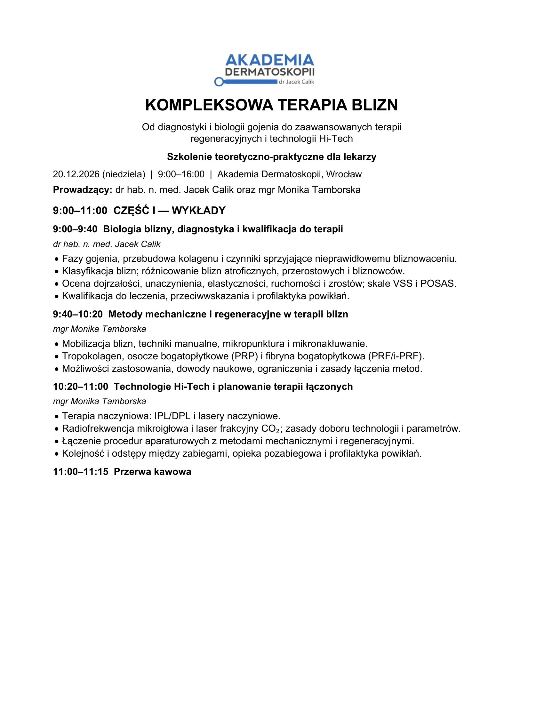
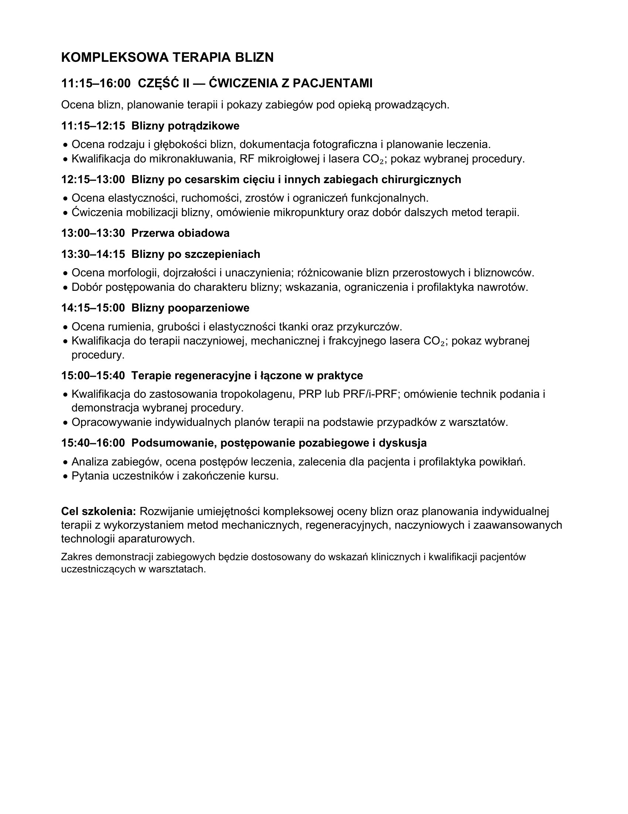

## Opis

Szkolenie teoretyczno-praktyczne dla lekarzy — **od diagnostyki i biologii gojenia do
zaawansowanych terapii regeneracyjnych i technologii Hi-Tech**. Rano wykłady, po południu
ćwiczenia z pacjentami: ocena blizn, planowanie terapii i pokazy zabiegów pod opieką
prowadzących.

**Cel szkolenia:** rozwijanie umiejętności kompleksowej oceny blizn oraz planowania indywidualnej
terapii z wykorzystaniem metod mechanicznych, regeneracyjnych, naczyniowych i zaawansowanych
technologii aparaturowych.

## Program

### Część I — wykłady (9:00–11:00)

**Biologia blizny, diagnostyka i kwalifikacja do terapii** — dr hab. n. med. Jacek Calik

- fazy gojenia, przebudowa kolagenu i czynniki sprzyjające nieprawidłowemu bliznowaceniu
- klasyfikacja blizn; różnicowanie blizn atroficznych, przerostowych i bliznowców
- ocena dojrzałości, unaczynienia, elastyczności, ruchomości i zrostów; skale VSS i POSAS
- kwalifikacja do leczenia, przeciwwskazania i profilaktyka powikłań

**Metody mechaniczne i regeneracyjne w terapii blizn** — mgr Monika Tamborska

- mobilizacja blizn, techniki manualne, mikropunktura i mikronakłuwanie
- tropokolagen, osocze bogatopłytkowe (PRP) i fibryna bogatopłytkowa (PRF/i-PRF)
- możliwości zastosowania, dowody naukowe, ograniczenia i zasady łączenia metod

**Technologie Hi-Tech i planowanie terapii łączonych** — mgr Monika Tamborska

- terapia naczyniowa: IPL/DPL i lasery naczyniowe
- radiofrekwencja mikroigłowa i laser frakcyjny CO₂; dobór technologii i parametrów
- łączenie procedur aparaturowych z metodami mechanicznymi i regeneracyjnymi
- kolejność i odstępy między zabiegami, opieka pozabiegowa i profilaktyka powikłań

### Część II — ćwiczenia z pacjentami (11:15–16:00)

- blizny potrądzikowe — ocena, dokumentacja fotograficzna, kwalifikacja do mikronakłuwania,
  RF mikroigłowej i lasera CO₂
- blizny po cesarskim cięciu i innych zabiegach chirurgicznych — ocena ruchomości i zrostów,
  ćwiczenia mobilizacji blizny
- blizny po szczepieniach — różnicowanie blizn przerostowych i bliznowców, profilaktyka nawrotów
- blizny pooparzeniowe — kwalifikacja do terapii naczyniowej, mechanicznej i frakcyjnego lasera CO₂
- terapie regeneracyjne i łączone w praktyce — tropokolagen, PRP, PRF/i-PRF; indywidualne plany
  terapii
- podsumowanie, postępowanie pozabiegowe i dyskusja

<callout variant="note" title="Pokazy zabiegów">
  Zakres demonstracji zabiegowych będzie dostosowany do wskazań klinicznych i kwalifikacji
  pacjentów uczestniczących w warsztatach.
</callout>

## Agenda

